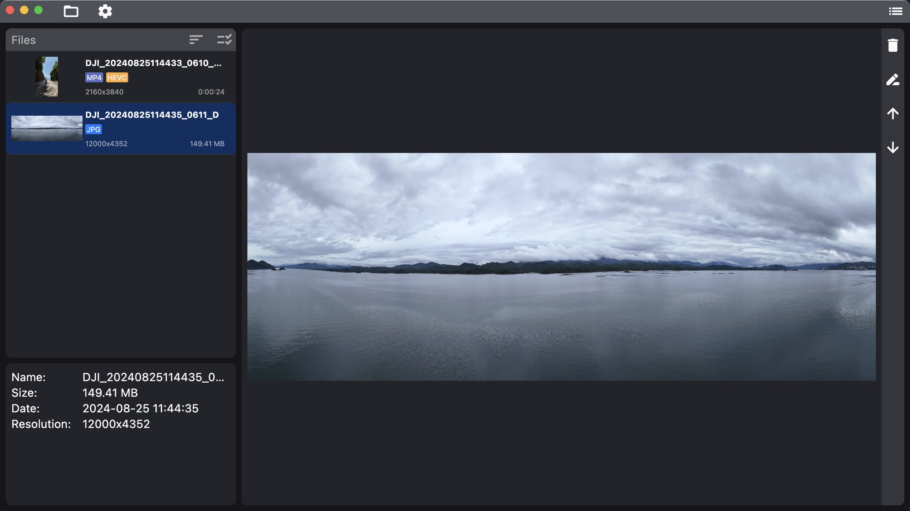
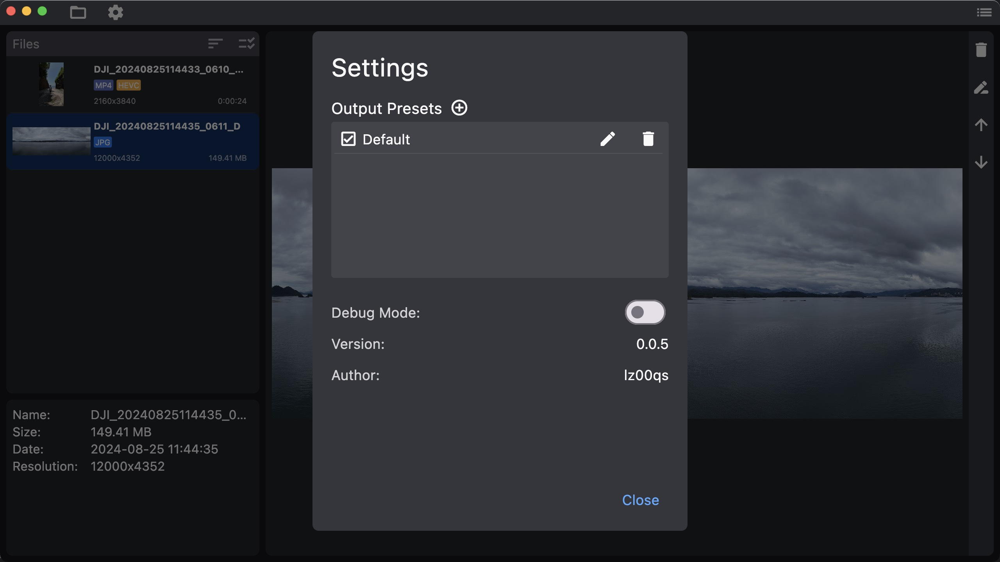

# xji_media_toolbox

## Introduction
This is a toolbox for DJI drone media processing. It base on flutter and can run on both Windows and MacOS. It can process the media files from DJI drones, including the following functions:
- File renaming
- Moving files to the system Trash or Recycle Bin
- Videos and photos preview
- Videos compression
- Videos trimming
- Videos merging
- AEB photos marking

> DNG photos are not tested.

## Installation
1. Download the latest version from the release page.
2. On Windows, run `XJI-Media-Toolbox-Setup-<version>-x64.exe`. On macOS,
   open the DMG and copy `XJI Media Toolbox` to Applications.
3. Launch `XJI Media Toolbox` from the Start menu or Applications folder.

> If you are using MacOS, you may need to allow the app to run in the system settings.(System Preferences -> Security & Privacy -> General -> Allow)

FFmpeg and FFprobe are included in the Windows x64 and macOS arm64 releases.
Advanced users can select a compatible custom FFmpeg directory under
`Settings > Advanced`. See [THIRD_PARTY_NOTICES.md](THIRD_PARTY_NOTICES.md) for
the bundled runtime versions, checksums, sources, and licenses.

## Usage
1. Open the media folder by clicking the `Open` button. (Warning: due to this app is still in development, please backup your media files before using this app, not suggested to use it on the original media files or SD cards.).
2. Select the media files you want to process. You can use arrow keys to navigate the files.
3. Select the function you want to use by clicking the buttons on the right side.
4. In settings, you can set the video compression parameters and debug mode.

## Development
This app is developed by Flutter. You can clone the source code and run it by yourself. The source code is in the `src` folder.

> For Windows, due to the `fvp` plugin does not support IDE debugging, you may need to run the app by `flutter run` in the terminal. See this [issue](https://github.com/wang-bin/fvp/issues/125) for more information.

Use `python build.py --build windows` on Windows x64 or
`python3 build.py --build macos` on Apple Silicon to create a release with the
bundled FFmpeg runtime. The build script verifies the runtime checksums before
building. The Windows command also compiles an Inno Setup installer under
`build/windows/installer/` and writes its SHA-256 checksum next to it. Install
Inno Setup 6 or 7, or set `INNO_SETUP_COMPILER` to the full path of `ISCC.exe`,
before building a Windows release.

## Todo
- [ ] i18n support
- [ ] DNG photos support
- [ ] Maybe migrate to electron for better performance and more features
